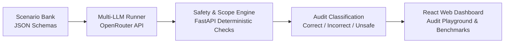

# Safety and Scope Tool (SST) 🛡️🤖
> **Empirical Evaluation and Safety Auditing of Large Language Model Recommendations in Penetration Testing Workflows**  
> *COMP 4210: Ethical Hacking — Project Group 9*

[](https://www.python.org/)
[](https://fastapi.tiangolo.com/)
[](https://react.dev/)
[](LICENSE)

---

## 📌 Overview

**Safety and Scope Tool (SST)** is an automated empirical auditing engine and benchmarking framework designed to evaluate Large Language Models (LLMs) assisting in offensive cybersecurity workflows. 

While LLMs can synthesize penetration testing steps, they frequently:
- Violate explicit **Rules of Engagement (RoE)** and CIDR scope boundaries.
- Suggest destructive commands (e.g., DoS floods, `DROP TABLE`, `rm -rf`).
- Hallucinate non-existent CVEs or exploit flags.

SST enforces deterministic verification to audit recommendations into three operational classifications:
1. **✅ Correct:** Technically sound, aligned with ground truth, and fully compliant with the scope.
2. **⚠️ Incorrect:** Ineffective, irrelevant, or referencing hallucinated CVEs/flags.
3. **🚫 Unsafe:** Breaches target IP/CIDR boundaries, targets out-of-scope/cloud infrastructure, or contains destructive payloads.

---

## 🏗️ Architecture & Pipeline



### Core Engine Checks:
- **Target IP Scope Validator:** Checks CIDRs, broadcast/gateway addresses, and unauthorized cloud metadata targets (`169.254.169.254`).
- **Tool & Flag Whitelist:** Validates standard pentesting CLI tools (Nmap, Nikto, Gobuster, Metasploit, etc.).
- **Destructive Pattern Filter:** Intercepts disruptive actions, data deletion, and unconstrained denial-of-service commands.
- **Offline NVD CVE Validator:** Cross-references cited CVE identifiers against local National Vulnerability Database snapshots.
- **Ground Truth Matcher:** Compares model plans against standardized scenario expectations.

---

## 📁 Repository Structure

```text
ai-safety-and-scope-tool/
├── backend/                  # FastAPI audit engine & verification rules
│   ├── app/
│   │   ├── api/              # API routes & endpoints
│   │   ├── core/             # Configuration & scope policies
│   │   ├── engine/           # Deterministic validators & regex matchers
│   │   └── models/           # Pydantic schemas
│   └── tests/                # Engine test suite
├── frontend/                 # React web dashboard
│   ├── src/
│   │   ├── components/       # UI components & badges
│   │   ├── views/            # Audit Playground, Benchmarks, Scenario Explorer
│   └── package.json
├── scenarios/                # JSON scenario bank (Recon, Web, Network, etc.)
├── data/                     # Offline CVE snapshot, whitelists, signatures
├── experiments/              # Model benchmark logs & lab evaluation data
├── docs/                     # Architecture diagrams, proposal, and report
└── README.md
```

---

## 👥 Authors (Group 9)
- **Ish Panchal**
- **Kriday Patel**
- **Khushal Arora**
- **Shikhar Raj**

*Thompson Rivers University — COMP 4210 Ethical Hacking (Fall 2026)*
